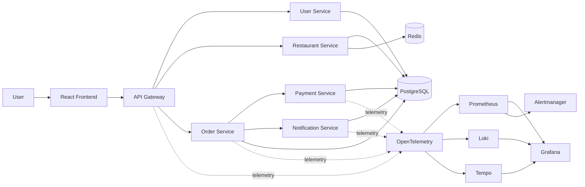

# REAL-TIME DEVOPS SRE — OBSERVABILITY & RELIABILITY PRODUCTION PROJECT

A complete hands-on DevOps/SRE lab for an Order Management Platform. It continues the Kubernetes → Docker/Registry → GitOps → DevSecOps series and focuses on operating a production-style system after deployment.

> Practice project: SLO, RPO and RTO values are learning targets, not contractual guarantees.

## Architecture



## Project structure

```text
app/                 React + FastAPI source code
database/             PostgreSQL schema/seed
docker-compose.yml    local application + observability
k8s/                  Kubernetes manifests
helm/                 Helm chart
gitops/               Argo CD desired state
terraform/            Azure AKS/ACR/Log Analytics
pipelines/            Azure DevOps + GitHub Actions
observability/        OTel/Prometheus/Grafana/Loki/Tempo/Alertmanager
load-tests/           k6 smoke/load/stress/spike
chaos/                controlled failure exercises
runbooks/             operator runbooks
incidents/            incident scenarios
postmortems/          postmortem templates
security/             SAST/SCA/Gitleaks/Trivy/SBOM/Cosign
scripts/              backup/restore/health/rollback
docs/                 hands-on guides
architecture/         Mermaid diagrams
```

# 1. Prerequisites

Local:
- Docker Desktop / Docker Engine + Compose
- Git
- curl
- Optional: `kubectl`, `helm`, `k6`, `terraform`, `az`, `argocd`

Azure:
- Azure subscription
- Azure CLI
- Terraform
- permissions to create Resource Group, AKS, ACR and Log Analytics

# 2. First hands-on run — Docker Compose

```bash
git clone <YOUR_REPO_URL>
cd devops-sre-observability-production-project
cp .env.example .env

docker compose build
docker compose up -d
docker compose ps
```

Open:

| Component | URL |
|---|---|
| Frontend | http://localhost:8080 |
| API Gateway | http://localhost:8000 |
| Gateway metrics | http://localhost:8000/metrics |
| Prometheus | http://localhost:9090 |
| Grafana | http://localhost:3000 |
| Alertmanager | http://localhost:9093 |
| Loki | http://localhost:3100 |
| Tempo | http://localhost:3200 |
| OTel Collector health | http://localhost:13133 |

Grafana local credentials: `admin` / `admin`.

Stop:

```bash
docker compose down
```

Reset all local volumes:

```bash
docker compose down -v
```

# 3. Test real application APIs

Register:

```bash
curl -X POST http://localhost:8000/api/users/register \
  -H 'content-type: application/json' \
  -d '{"email":"demo@example.com","password":"Passw0rd!123","name":"Demo User"}'
```

Login:

```bash
curl -X POST http://localhost:8000/api/users/login \
  -H 'content-type: application/json' \
  -d '{"email":"demo@example.com","password":"Passw0rd!123"}'
```

Copy the `access_token`.

Restaurants:

```bash
curl http://localhost:8000/api/restaurants
curl http://localhost:8000/api/restaurants/1
```

Create an order:

```bash
curl -X POST http://localhost:8000/api/orders \
  -H 'content-type: application/json' \
  -H "authorization: Bearer <TOKEN>" \
  -d '{"restaurant_id":1,"items":[{"menu_item_id":1,"quantity":2}]}'
```

Order history:

```bash
curl http://localhost:8000/api/orders \
  -H "authorization: Bearer <TOKEN>"
```

# 4. The SRE workflow

Generate traffic:

```bash
k6 run load-tests/smoke.js
k6 run load-tests/order-api.js
```

Then:

1. Grafana → Prometheus: find request rate and latency.
2. Grafana → Loki: filter service/error logs.
3. Copy `trace_id`.
4. Grafana → Tempo: inspect the distributed trace.
5. Identify the slow/error span.
6. Apply the relevant runbook.
7. Validate the SLO recovered.
8. Document the event in `incidents/`.
9. Complete a postmortem in `postmortems/`.

The core SRE loop is:

**Alert → Metrics → Logs → Traces → Root Cause → Mitigation → Validation → Learning**

# 5. Golden Signals

- **Latency:** API response duration.
- **Traffic:** requests per second.
- **Errors:** HTTP 5xx ratio and failed business operations.
- **Saturation:** CPU, memory, DB connections and other capacity limits.

Useful PromQL:

```promql
sum(rate(http_requests_total[5m]))

sum(rate(http_requests_total{status=~"5.."}[5m]))
/
clamp_min(sum(rate(http_requests_total[5m])), 1)

histogram_quantile(
  0.99,
  sum(rate(http_request_duration_seconds_bucket[5m])) by (le)
)
```

# 6. Practice SLOs

| SLI | Target | Error budget |
|---|---:|---:|
| API availability | 99.9% | 0.1% |
| API latency < 500 ms | 99% | 1% |
| Order creation success | 99.9% | 0.1% |
| Payment success | 99.5% | 0.5% |

These are project targets.

# 7. Kubernetes

Build and push images:

```bash
az login
az acr login --name <ACR_NAME>

docker build -t <ACR_LOGIN_SERVER>/order-management/order-service:1.0.0 \
  -f app/order-service/Dockerfile .

docker push <ACR_LOGIN_SERVER>/order-management/order-service:1.0.0
```

Deploy:

```bash
kubectl apply -f k8s/namespace.yaml
kubectl apply -f k8s/configmap.yaml
kubectl apply -f k8s/serviceaccounts.yaml
kubectl apply -f k8s/rbac.yaml
kubectl apply -f k8s/networkpolicies.yaml
kubectl apply -f k8s/postgres.yaml
kubectl apply -f k8s/redis.yaml
kubectl apply -f k8s/app.yaml
kubectl apply -f k8s/hpa.yaml
kubectl apply -f k8s/pdb.yaml
kubectl apply -f k8s/ingress.yaml
```

Inspect:

```bash
kubectl get pods -n order-sre
kubectl get svc -n order-sre
kubectl get hpa -n order-sre
kubectl top pods -n order-sre
kubectl get events -n order-sre --sort-by=.lastTimestamp
```

Rollback:

```bash
kubectl rollout history deployment/order-service -n order-sre
kubectl rollout undo deployment/order-service -n order-sre
kubectl rollout status deployment/order-service -n order-sre
```

# 8. Helm

```bash
helm lint helm/order-observability
helm template order-management helm/order-observability \
  -f helm/order-observability/values-dev.yaml

helm upgrade --install order-management helm/order-observability \
  -n order-sre --create-namespace \
  -f helm/order-observability/values-dev.yaml
```

# 9. GitOps / Argo CD

Replace `REPLACE_ORG` in `gitops/applications/*.yaml`.

```bash
git add gitops/
git commit -m "promote order service"
git push
```

Then:

```bash
argocd app get order-management-dev
argocd app sync order-management-dev
argocd app history order-management-dev
```

Git remains the desired-state source of truth.

# 10. Terraform / Azure

```bash
cd terraform
cp terraform.tfvars.example terraform.tfvars
terraform init
terraform fmt -recursive
terraform validate
terraform plan
terraform apply
```

Review the plan before applying.

Cleanup:

```bash
terraform destroy
```

# 11. Load testing

```bash
k6 run load-tests/smoke.js
k6 run load-tests/order-api.js
k6 run load-tests/stress.js
k6 run load-tests/spike.js
```

Watch HPA:

```bash
kubectl get hpa -n order-sre -w
```

# 12. Controlled chaos

Safe first experiment:

```bash
kubectl delete pod -n order-sre -l app=order-service
kubectl get pods -n order-sre -w
```

Expected learning:
- Kubernetes recreates the pod.
- PDB/replicas reduce availability risk.
- Prometheus/Grafana should show the event.
- Logs/events help explain recovery.

Never run destructive chaos in production without an approved experiment and rollback plan.

# 13. Backup / restore

```bash
./scripts/backup-db.sh
./scripts/restore-db.sh backups/order_management_latest.sql
```

Practice targets:
- RPO: 15 minutes
- RTO: 30 minutes

# 14. CI/CD security chain

```text
Checkout
  ↓
Lint + Unit Tests + Coverage
  ↓
SAST + Dependency Scan + Secret Scan
  ↓
Docker Build
  ↓
Trivy
  ↓
SBOM
  ↓
Cosign Signing
  ↓
ACR
  ↓
GitOps
  ↓
Argo CD
  ↓
AKS
```

Review:
- `pipelines/devops-sre-ci.yml`
- `pipelines/github-actions.yml`

# 15. Production checklist

Before production:
- immutable image tags/digests
- authenticated Grafana
- TLS
- managed secrets / Workload Identity
- RBAC and NetworkPolicies
- resource requests/limits
- tested backups/restores
- tested rollback
- SLO ownership
- alert routing/on-call
- runbooks
- disaster-recovery exercise

# 16. Learning order

1. `docs/LOCAL-SETUP.md`
2. `docs/OBSERVABILITY.md`
3. `docs/PROMETHEUS.md`
4. `docs/GRAFANA.md`
5. `docs/SLI-SLO.md`
6. `docs/ERROR-BUDGET.md`
7. `docs/BURN-RATE.md`
8. `docs/INCIDENT-MANAGEMENT.md`
9. `docs/ROOT-CAUSE-ANALYSIS.md`
10. `docs/PRODUCTION-OPERATIONS.md`
11. `docs/TROUBLESHOOTING.md`
12. `docs/INTERVIEW-QUESTIONS.md`
