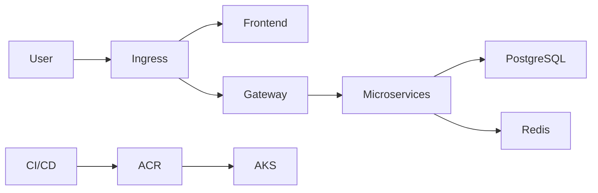

# Architecture

The gateway is the stestinglab.comle API entry point. Services communicate over Kubernetes DNS. PostgreSQL stores durable order/business data; Redis handles cache and temporary state.
