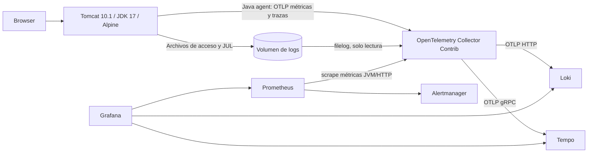

# Tomcat 10 + JDK 17 sobre Alpine y Docker Compose

Laboratorio independiente para Linux con Compose Specification (CLI `docker compose`, sin el campo obsoleto `version`). Requiere Docker Engine, el plugin Docker Compose v2 o posterior, Bash 4+, curl, jq, openssl y aproximadamente 4 GB de RAM disponibles. El usuario debe tener acceso al daemon Docker.

## Arquitectura



Collector Contrib incluye el receptor **filelog**, que es el agente de recogida de logs necesario. No hace falta otro recolector. Lee logs de acceso de Tomcat y logs JUL; el exportador de logs del agente Java está desactivado para evitar duplicados. Los logs del resto de contenedores quedan accesibles mediante `docker compose logs`, con rotación. Tempo almacena las trazas que OpenTelemetry genera; Grafana incorpora las tres fuentes y un panel inicial.

## Arranque en Linux (Bash)

Desde este directorio, con Docker Engine arrancado:

```bash
# En Debian/Ubuntu, si faltan herramientas auxiliares:
# sudo apt-get install bash curl jq openssl
# Docker Engine y el plugin Compose deben estar previamente instalados.
bash scripts/setup.sh
cat secrets/grafana_admin_password.txt
docker compose up -d --build
docker compose ps
# Ejecutar cuando los servicios estén listos; repetir si aún arrancan.
bash scripts/smoke.sh
```

`setup.sh` conserva los secretos existentes y crea una contraseña aleatoria si falta. Protege `secrets/` con permisos 0700 y deja el archivo 0444 para que Grafana (UID 472) pueda leer el secreto montado. Los scripts se invocan con `bash`, sin necesitar permisos de ejecución. `.gitattributes` mantiene finales de línea LF para Linux.

La primera descarga/construcción tarda varios minutos. `init-volumes` termina con código 0 tras preparar permisos; es normal que no permanezca activo. Las dependencias esperan inicio de procesos, no disponibilidad completa; los exportadores reintentan mientras arrancan los destinos.

| Servicio | URL local |
| --- | --- |
| Aplicación | http://localhost:8080 |
| Grafana | http://localhost:3000 (admin y contraseña generada) |
| Prometheus | http://localhost:9090 |
| Alertmanager | http://localhost:9093 |

## Verificar la telemetría

Genera tráfico con `bash scripts/smoke.sh` y espera unos 30 segundos. En Grafana abre el dashboard **Tomcat observability** o Explore:

- Prometheus: `jvm_memory_used_bytes{service_name="tomcat"}` y `up`.
- Loki: `{service_name="tomcat"}` para acceso y errores. Los eventos JUL multilínea se conservan como líneas individuales. Este laboratorio no añade correlación automática de trace ID a los logs JUL/acceso.
- Tempo, búsqueda TraceQL: `{ resource.service.name = "tomcat" }`.
- Prometheus muestra los targets en `/targets` y las reglas en `/alerts`.

Al parar Tomcat (`docker compose stop tomcat`), `TomcatTelemetryMissing` se activa después de expirar las series antiguas y mantenerse ausente durante 3 minutos. Al parar Collector se activa `ObservabilityTargetDown` tras 2 minutos. Reiniciar con `docker compose start tomcat otel-collector`.

Alertmanager agrupa alertas y las muestra en su UI. El receptor `local` no envía correos ni mensajes; configura un receptor real en `config/alertmanager.yaml` para recibir notificaciones externas.

## Controles de seguridad

```bash
# Checkov del Dockerfile + construcción + Trivy de la imagen final
bash scripts/security.sh
# También analiza todas las imágenes de terceros del Compose
bash scripts/security.sh --all-images
```

Checkov comprueba prácticas del Dockerfile (usuario, HEALTHCHECK, etiquetas, etc.); Trivy comprueba CVE y secretos de la imagen construida. Se usan herramientas en contenedores, sin instalaciones Python ni acceso al socket Docker. Trivy genera informes JSON en `reports/`, cachea su base de vulnerabilidades y falla ante HIGH/CRITICAL, incluidas vulnerabilidades sin parche. Checkov también provoca fallo ante incumplimientos. No se suprimen CVE para conseguir un resultado verde. Solo se justifican las excepciones de usuario/healthcheck en la etapa de descarga que no se distribuye como imagen final.

El análisis descarga bases actualizadas y necesita Internet. Un resultado satisfactorio depende de las vulnerabilidades conocidas en el momento de ejecución; no se presupone que estas versiones estén libres de CVE. Actualiza etiquetas, reconstruye y vuelve a escanear antes de publicar. Las versiones se fijan por etiqueta, no por digest; para una cadena de suministro inmutable fija los digests tras verificar las imágenes. El tar de Tomcat se contrasta con su checksum oficial descargado por HTTPS. El agente Java se verifica contra el SHA-256 fijado en el Dockerfile y publicado en sus [assets oficiales](https://github.com/open-telemetry/opentelemetry-java-instrumentation/releases/expanded_assets/v2.26.1); actualizar su versión requiere actualizar también ese hash.

## Alcance y mantenimiento

Tomcat corre como UID 10001, con raíz de solo lectura, sin capabilities y con límites de memoria/CPU. Los puertos publicados se restringen a loopback. El único contenedor root es el inicializador de permisos, sin red y con capabilities limitadas; los servicios persistentes usan usuarios sin privilegios. Los secretos Compose locales son archivos montados, no un almacén cifrado; no los subas a Git. Grafana conserva la contraseña inicial en su base: cambiar el archivo no resetea una cuenta ya creada.

Persistencia en volúmenes nombrados: logs de Tomcat (rotación diaria de acceso/JUL de Tomcat), offsets y colas de Collector, métricas (7 días), logs Loki (7 días), trazas Tempo (24 horas) y Grafana. Revisa espacio en disco y ajusta retenciones según carga. No hay TLS ni autenticación interna para los backends; el diseño es para un equipo local, no para exposición pública ni alta disponibilidad. No incluye métricas del host Linux.

Si Linux está en un servidor remoto, abre un túnel desde tu equipo para acceder a Grafana y Tomcat: `ssh -L 3000:127.0.0.1:3000 -L 8080:127.0.0.1:8080 usuario@servidor`. Después usa las URL locales de la tabla.

```bash
docker compose logs --tail 100 tomcat otel-collector
docker compose down       # conserva datos
# Solo si quieres borrar todos los datos del laboratorio:
docker compose down -v
```

Referencias: [Tomcat 10](https://tomcat.apache.org/download-10.cgi), [OpenTelemetry Java](https://github.com/open-telemetry/opentelemetry-java-instrumentation), [Collector filelog](https://github.com/open-telemetry/opentelemetry-collector-contrib/tree/main/receiver/filelogreceiver), [Loki OTLP](https://grafana.com/docs/loki/latest/send-data/otel/), [Checkov Dockerfile](https://www.checkov.io/7.Scan%20Examples/Dockerfile.html), [Trivy](https://trivy.dev/docs/latest/).
