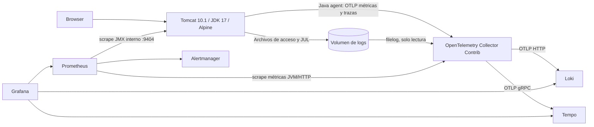

# Tomcat 10 + JDK 17 sobre Alpine y Docker Compose

Laboratorio independiente para Linux con Compose Specification (CLI `docker compose`, sin el campo obsoleto `version`). Requiere Docker Engine, el plugin Docker Compose v2 o posterior, Bash 4+, curl, jq, openssl y aproximadamente 4 GB de RAM disponibles. El usuario debe tener acceso al daemon Docker.

## Arquitectura



Collector Contrib incluye el receptor **filelog**, que es el agente de recogida de logs necesario. No hace falta otro recolector. Lee logs de acceso de Tomcat y logs JUL; el exportador de logs del agente Java está desactivado para evitar duplicados. Los logs del resto de contenedores quedan accesibles mediante `docker compose logs`, con rotación. Tempo almacena las trazas que OpenTelemetry genera. JMX Exporter se ejecuta como segundo agente dentro de Tomcat y expone las métricas `tomcat_*` que usa el dashboard; el puerto 9404 solo es accesible dentro de la red Compose.

## Dashboard Tomcat 8704 con logs

**Tomcat observability** se basa en el [dashboard 8704, revisión 1](https://grafana.com/grafana/dashboards/8704-tomcat-dashboard/). Incluye los tres paneles de la captura `tomcat_screenshot-1.png` en la parte superior: Targets disponibles y Memoria JVM en la primera fila, seguidos de Logs de Tomcat a todo el ancho. Debajo conserva los 16 paneles de métricas del 8704: 19 paneles en total. No necesitas importarlo manualmente; se provisiona desde `grafana/dashboards/tomcat.json` con las fuentes ya configuradas. Usa el dashboard con UID `tomcat-observability`; importar el original 8704 por separado no incluye nuestras adaptaciones ni el panel de logs.

Adaptaciones para este entorno:

- Paneles antiguos `graph` y `singlestat` convertidos a `timeseries` y `stat` para Grafana 12.
- Job `tomcat-jmx`, con selectores de instancia y protocolo. Las sesiones activas se obtienen de su gauge JMX, evitando restar contadores de distintas instancias.
- Los contadores antiguos de acceptor/poller threads se sustituyen por connection timeout y max connections, atributos disponibles en el conector NIO de Tomcat 10.1.
- Logs con hora visible, ajuste de línea, detalles expandibles, orden más reciente primero y hasta 1000 líneas por consulta. El campo **Log search (literal)** filtra el texto; vacío muestra todo. Los filtros Job/Instance/Protocol afectan a las métricas JMX; los logs corresponden al único servicio Tomcat de este Compose.
- El enlace **Explore / Tempo** permite consultar trazas. Se conserva el UID `tomcat-observability`, por lo que tu enlace anterior al dashboard sigue funcionando.
- El resumen superior no depende de los filtros JMX: muestra todos los targets y la memoria JVM de Tomcat recibida por OpenTelemetry. Así puedes comprobar esas rutas aunque fallen las métricas JMX.

### Actualizar una instalación existente en Linux

Con estos archivos actualizados en el servidor, ejecuta desde `tomcat-observability/`:

```bash
docker compose config --quiet
docker compose up -d --build tomcat
# Recargar configuración de scrape y provisioning del dashboard.
docker compose restart prometheus grafana
docker compose ps
# Cuando Tomcat esté healthy, esperar unos 30 segundos para el primer scrape.
bash scripts/smoke.sh
```

La construcción añade JMX Exporter 1.6.0, verificado contra el SHA-256 oficial fijado en el Dockerfile. No borres volúmenes: se conservan credenciales y datos. Abre `http://IP_DEL_SERVIDOR:3000/d/tomcat-observability` y recarga el navegador. Los gráficos basados en incrementos de cinco minutos necesitarán tráfico y al menos dos scrapes para mostrar resultados; algunos contadores de errores pueden permanecer en cero.

## Arranque en Linux (Bash)

Desde la raíz del repositorio, entra primero al directorio del proyecto. Si ya estás en `tomcat-observability/`, omite el `cd`. Docker Engine debe estar arrancado y tu usuario debe tener acceso al daemon.

```bash
cd tomcat-observability
# En Debian/Ubuntu, si faltan herramientas auxiliares:
# sudo apt-get install bash curl jq openssl
# Docker Engine y el plugin Compose deben estar previamente instalados.
docker info
docker compose version
bash scripts/setup.sh
cat secrets/grafana_admin_password.txt
docker compose up -d --build
docker compose ps
# Ejecutar cuando los servicios estén listos; repetir si aún arrancan.
bash scripts/smoke.sh
```

`setup.sh` conserva los secretos existentes y crea una contraseña aleatoria si falta. Protege `secrets/` con permisos 0700 y deja el archivo 0444 para que Grafana (UID 472) pueda leer el secreto montado. Los scripts se invocan con `bash`, sin necesitar permisos de ejecución. `.gitattributes` mantiene finales de línea LF para Linux.

La primera descarga/construcción tarda varios minutos. `init-volumes` termina con código 0 tras preparar permisos; es normal que no permanezca activo. Las dependencias esperan inicio de procesos, no disponibilidad completa; los exportadores reintentan mientras arrancan los destinos.

| Servicio | URL local |
| --- | --- |
| Aplicación | http://localhost:8080 |
| Grafana | http://localhost:3000 (admin y contraseña generada) |
| Prometheus | http://localhost:9090 |
| Alertmanager | http://localhost:9093 |

### Acceso desde otro equipo

Los cuatro puertos publicados escuchan por defecto en todas las interfaces (`BIND_ADDRESS=0.0.0.0`). Desde otro equipo, sustituye `localhost` por la IP del servidor Linux: por ejemplo, `http://192.168.1.50:3000` para Grafana.

Para aplicar este cambio a un despliegue existente, comprueba que `.env` no fija `BIND_ADDRESS=127.0.0.1`. Añade o cambia la variable a `BIND_ADDRESS=0.0.0.0`, y ejecuta desde `tomcat-observability/`:

```bash
docker compose config --quiet
docker compose up -d
docker compose ps
```

Compose recrea los contenedores cuyos puertos cambian conservando los volúmenes. No hace falta reconstruir la imagen ni borrar los datos. Puedes usar la IP de una interfaz concreta en `BIND_ADDRESS` para limitar dónde escucha. Si no responde desde otro equipo, revisa el firewall del servidor y, si corresponde, las reglas de red del proveedor: deben permitir TCP 3000, 8080, 9090 y 9093 desde tu equipo o red de administración. Prometheus y Alertmanager no tienen autenticación configurada; limita su acceso a esa red.

## Verificar la telemetría

### Si faltan datos o no aparece el panel de logs

Actualiza los archivos del proyecto en el servidor, reconstruye Tomcat y recarga los servicios que leen configuración al arrancar:

```bash
docker compose up -d --build tomcat
docker compose restart prometheus grafana
# Genera solicitudes nuevas para las metricas, logs de acceso y trazas.
for i in {1..10}; do curl -fsS http://localhost:8080/; done
# Tras unos 30 segundos:
bash scripts/diagnose.sh
```

El diagnóstico muestra los paneles realmente montados en Grafana, el estado y error de cada target, las familias métricas presentes, la respuesta directa de JMX Exporter y una consulta interna a Loki. No modifica datos. Los logs de la aplicación pueden contener información sensible: revisa la salida antes de compartirla.

En el navegador abre `/d/tomcat-observability`, selecciona Job `tomcat-jmx`, Instance `All`, Protocol `All` y vacía Log search. Un job JMX ausente en `/api/v1/targets` indica que Prometheus no ha cargado la configuración nueva. Si está `down`, el diagnóstico muestra el error de conexión. Si está `up` pero no hay familias `tomcat_*`, revisa la salida directa del exporter y las reglas JMX. Un panel ausente es un problema de dashboard/provisioning; un panel visible sin resultados requiere comprobar la consulta Loki y los logs del Collector.

### Para qué se usa OpenTelemetry

| Componente | Función en este proyecto | Destino |
| --- | --- | --- |
| Agente Java OpenTelemetry | Instrumenta solicitudes HTTP y genera trazas y métricas JVM/HTTP | Collector por OTLP |
| Collector: pipeline metrics | Expone las métricas recibidas del agente | Prometheus, job `tomcat-otel` |
| Collector: pipeline traces | Agrupa y envía las trazas del agente | Tempo; consultar desde Explore |
| Collector: pipeline logs | Lee archivos JUL/acceso con filelog y los envía por OTLP HTTP | Loki; panel Logs de Tomcat |
| JMX Exporter | Expone MBeans de conectores, sesiones y servlets con nombres `tomcat_*` compatibles con 8704 | Prometheus, job `tomcat-jmx` |

El dashboard 8704 consulta JMX, no las métricas del agente OpenTelemetry. Ambas rutas se mantienen porque el dashboard necesita los nombres JMX y OpenTelemetry aporta trazas y la recogida centralizada de logs. El panel Loki usa el Collector, no JMX; las trazas se consultan en Tempo, no en ese panel.

### Consultas

Genera tráfico con `bash scripts/smoke.sh` y espera unos 30 segundos. En Grafana abre el dashboard **Tomcat observability** o Explore:

- Prometheus: `jvm_memory_used_bytes{service_name="tomcat"}` y `up`.
- JMX: `tomcat_requestcount_total{job="tomcat-jmx"}` y `tomcat_threadpool_currentthreadsbusy{job="tomcat-jmx"}`. El script smoke comprueba cinco familias JMX necesarias para el dashboard, además de HTTP y los targets.
- Loki: `{service_name="tomcat"}` para acceso y errores. Los eventos JUL multilínea se conservan como líneas individuales. Este laboratorio no añade correlación automática de trace ID a los logs JUL/acceso.
- Tempo, búsqueda TraceQL: `{ resource.service.name = "tomcat" }`.
- Prometheus muestra los targets en `/targets` y las reglas en `/alerts`.

Al parar Tomcat (`docker compose stop tomcat`), `TomcatTelemetryMissing` se activa después de expirar las series antiguas y mantenerse ausente durante 3 minutos. Al parar Collector se activa `ObservabilityTargetDown` tras 2 minutos. Reiniciar con `docker compose start tomcat otel-collector`.

Alertmanager agrupa alertas y las muestra en su UI. El receptor `local` no envía correos ni mensajes; configura un receptor real en `config/alertmanager.yaml` para recibir notificaciones externas.

## Controles de seguridad

### Recuperar acceso a Grafana

Si el log contiene `too many consecutive incorrect login attempts`, el usuario está temporalmente bloqueado. Grafana 12.1.1 cuenta los intentos fallidos en una ventana de cinco minutos. Deja de intentar entrar durante al menos cinco minutos; no hace falta borrar volúmenes ni desactivar la protección. El bloqueo por sí solo no confirma si la contraseña usada es correcta.

Si necesitas restablecer la contraseña al valor del secreto, desde este directorio ejecuta:

```bash
docker compose exec -T grafana \
  grafana cli --homepath /usr/share/grafana \
  --config /etc/grafana/grafana.ini \
  --configOverrides cfg:default.paths.data=/var/lib/grafana \
  admin reset-admin-password --password-from-stdin \
  < secrets/grafana_admin_password.txt
```

Comprueba que termina indicando que la contraseña se ha cambiado. Espera a que expire cualquier bloqueo y usa la contraseña del archivo, sin espacios añadidos, con el usuario original de la instalación (por defecto `admin`). Cambiar `GRAFANA_ADMIN_USER` o el secreto no modifica una cuenta ya existente.

El directorio `grafana/provisioning/alerting/` se incluye vacío para evitar avisos por ausencia de esa ruta; las alertas de este proyecto se configuran en Prometheus y Alertmanager.

### Escanear las imágenes

```bash
# Checkov del Dockerfile + construcción + Trivy de la imagen final
bash scripts/security.sh
# También analiza todas las imágenes de terceros del Compose
bash scripts/security.sh --all-images
```

Checkov comprueba prácticas del Dockerfile (usuario, HEALTHCHECK, etiquetas, etc.); Trivy comprueba CVE y secretos de la imagen construida. Se usan herramientas en contenedores, sin instalaciones Python ni acceso al socket Docker. Trivy genera informes JSON en `reports/`, cachea su base de vulnerabilidades y falla ante HIGH/CRITICAL, incluidas vulnerabilidades sin parche. Checkov también provoca fallo ante incumplimientos. No se suprimen CVE para conseguir un resultado verde. Solo se justifican las excepciones de usuario/healthcheck en la etapa de descarga que no se distribuye como imagen final.

El análisis descarga bases actualizadas y necesita Internet. Un resultado satisfactorio depende de las vulnerabilidades conocidas en el momento de ejecución; no se presupone que estas versiones estén libres de CVE. Actualiza etiquetas, reconstruye y vuelve a escanear antes de publicar. Las versiones se fijan por etiqueta, no por digest; para una cadena de suministro inmutable fija los digests tras verificar las imágenes. El tar de Tomcat se contrasta con su checksum oficial descargado por HTTPS. El agente Java se verifica contra el SHA-256 fijado en el Dockerfile y publicado en sus [assets oficiales](https://github.com/open-telemetry/opentelemetry-java-instrumentation/releases/expanded_assets/v2.26.1); actualizar su versión requiere actualizar también ese hash.

## Alcance y mantenimiento

Tomcat corre como UID 10001, con raíz de solo lectura, sin capabilities y con límites de memoria/CPU. La variable BIND_ADDRESS controla la interfaz de los puertos publicados; por defecto escuchan en todas las interfaces. El único contenedor root es el inicializador de permisos, sin red y con capabilities limitadas; los servicios persistentes usan usuarios sin privilegios. Los secretos Compose locales son archivos montados, no un almacén cifrado; no los subas a Git. Grafana conserva la contraseña inicial en su base: cambiar el archivo no resetea una cuenta ya creada.

Persistencia en volúmenes nombrados: logs de Tomcat (rotación diaria de acceso/JUL de Tomcat), offsets y colas de Collector, métricas (7 días), logs Loki (7 días), trazas Tempo (24 horas) y Grafana. Revisa espacio en disco y ajusta retenciones según carga. No hay TLS ni autenticación interna para los backends; el diseño es para un equipo local, no para exposición pública ni alta disponibilidad. No incluye métricas del host Linux.

Para acceso exclusivo mediante túnel SSH, configura `BIND_ADDRESS=127.0.0.1` en `.env`, aplica con `docker compose up -d` y abre el túnel desde tu equipo: `ssh -L 3000:127.0.0.1:3000 -L 8080:127.0.0.1:8080 usuario@servidor`. Después usa las URL locales de la tabla.

```bash
docker compose logs --tail 100 tomcat otel-collector
docker compose down       # conserva datos
# Solo si quieres borrar todos los datos del laboratorio:
docker compose down -v
```

Referencias: [Tomcat 10](https://tomcat.apache.org/download-10.cgi), [OpenTelemetry Java](https://github.com/open-telemetry/opentelemetry-java-instrumentation), [Collector filelog](https://github.com/open-telemetry/opentelemetry-collector-contrib/tree/main/receiver/filelogreceiver), [Loki OTLP](https://grafana.com/docs/loki/latest/send-data/otel/), [Checkov Dockerfile](https://www.checkov.io/7.Scan%20Examples/Dockerfile.html), [Trivy](https://trivy.dev/docs/latest/).
