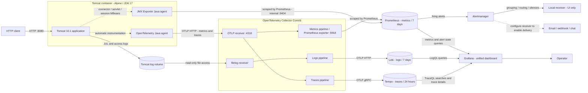

# Tomcat 10, JDK 17, and observability on Alpine Linux

A standalone Linux lab using Docker Engine and Docker Compose v2 or later. It includes Tomcat, Prometheus, Grafana, Alertmanager, Loki, OpenTelemetry Collector Contrib, and Tempo. Requirements: Bash 4+, curl, jq, openssl, access to the Docker daemon, Internet access for image downloads and vulnerability databases, and approximately 4 GB of available RAM.

## Architecture and signal flow



The arrows identify the telemetry paths; Prometheus pulls both metrics endpoints. Loki and Tempo store different signals: Loki stores log events, while Tempo stores traces made up of timed spans. Grafana queries all three backends.

| Component | Responsibility | Where it is used |
| --- | --- | --- |
| OpenTelemetry Java agent | Automatically instruments HTTP requests and produces request traces and JVM/HTTP metrics | Attached to the Tomcat JVM |
| OpenTelemetry Collector | Receives OTLP, reads log files, batches telemetry, and forwards each signal | Metrics to Prometheus, logs to Loki, traces to Tempo |
| JMX Exporter | Exposes Tomcat connector, servlet, and session MBeans as `tomcat_*` metrics | Dashboard 8704 panels, Prometheus job `tomcat-jmx` |
| Prometheus | Scrapes metrics and evaluates alert rules | Metrics charts, active alert panels, and alerts sent to Alertmanager |
| Alertmanager | Groups and routes firing alerts and supports silences | UI on port 9093; external delivery requires a receiver |
| Loki | Stores and searches JUL and access logs | Tomcat logs panel and Grafana Explore |
| Tempo | Stores request traces, including span timing, duration, and errors | Recent Tomcat traces panel and Grafana Explore |
| Grafana | Presents metrics, logs, alert state, and traces | Unified Tomcat dashboard |

OpenTelemetry is the instrumentation and collection layer, not a storage backend. Tempo provides the trace storage. JMX remains because dashboard 8704 expects JMX metric names. The Java agent's log exporter is disabled to avoid duplicate ingestion; Collector reads Tomcat log files with `filelog` instead. Other containers' stdout/stderr logs remain available through `docker compose logs` with rotation.

## Start on Linux

From the repository root:

```bash
cd tomcat-observability/dockercompose
# Debian/Ubuntu auxiliary tools, if missing:
# sudo apt-get install bash curl jq openssl
# Rocky Linux auxiliary tools, if missing:
# sudo dnf install bash curl jq openssl
# Install Docker Engine and its Compose plugin separately.
docker info
docker compose version
bash scripts/setup.sh
cat secrets/grafana_admin_password.txt
docker compose up -d --build
docker compose ps
```

The initial build can take several minutes. Once Tomcat is healthy, generate traffic and allow approximately 30 seconds for telemetry export and scraping:

```bash
for i in {1..10}; do curl -fsS http://localhost:8080/; done
# Run after the first scrapes have completed:
bash scripts/smoke.sh
```

`setup.sh` preserves existing secrets and generates a password only when the file is missing. The `secrets/` directory is mode 0700; its password file is mode 0444 so Grafana UID 472 can read the mounted secret. Scripts are invoked with Bash and do not require executable permissions. `.gitattributes` keeps shell scripts on LF line endings.

`init-volumes` prepares volume ownership and exits successfully; it is not a persistent service. Startup dependencies wait for processes, not full backend readiness. Exporters retry while backends initialize.

| Service | Local URL | Remote URL |
| --- | --- | --- |
| Tomcat | http://localhost:8080 | http://SERVER_IP:8080 |
| Grafana | http://localhost:3000 | http://SERVER_IP:3000 |
| Prometheus | http://localhost:9090 | http://SERVER_IP:9090 |
| Alertmanager | http://localhost:9093 | http://SERVER_IP:9093 |

Grafana uses `admin` by default and the password in `secrets/grafana_admin_password.txt`. Open `/d/tomcat-observability` for the provisioned dashboard.

Published ports bind to all interfaces by default (`BIND_ADDRESS=0.0.0.0`). Set a specific interface IP or `127.0.0.1` in `.env` and apply with `docker compose up -d`. Allow the published TCP ports through the host/provider firewall only from your administration network. Prometheus and Alertmanager do not have authentication configured. Loki, Tempo, Collector, and the JMX endpoint have no published host ports.

For SSH-only access, set `BIND_ADDRESS=127.0.0.1` and run this on your workstation:

```bash
ssh -L 3000:127.0.0.1:3000 -L 8080:127.0.0.1:8080 user@server
```

## Dashboard: metrics, logs, alerts, and traces

The provisioned **Tomcat observability** dashboard uses UID `tomcat-observability` and is based on [Grafana dashboard 8704, revision 1](https://grafana.com/grafana/dashboards/8704-tomcat-dashboard/). Importing the upstream dashboard separately does not include this project's adaptations.

The dashboard contains 22 panels:

- **Available targets** and **JVM memory** retain the overview from `tomcat_screenshot-1.png`. Memory comes from the OpenTelemetry metrics pipeline.
- **Tomcat logs** spans the full width and includes timestamps, line wrapping, expandable details, newest-first ordering, and up to 1000 lines per query. **Log search (literal)** filters text; leave it empty to see all logs.
- **Firing alerts** and **Active alert rules** show Prometheus alert state. Zero firing alerts or an empty active-alert table is normal when no rule is active. These panels do not prove that external notifications have been delivered.
- **Recent Tomcat traces (Tempo)** searches traces generated by OpenTelemetry. Select a trace ID to inspect its spans in Explore. Generate HTTP requests and select a time range that includes them.
- The original 16 Tomcat panels follow, with `tomcat-jmx` job, instance, and protocol selectors.

JMX filters affect the original metrics panels only. The overview, logs, alerts, and traces cover the lab services independently. There is only one Tomcat instance in this Compose deployment.

Legacy `graph` and `singlestat` panels are converted to `timeseries` and `stat` for Grafana 12. Active sessions use the JMX gauge. Acceptor/poller thread counters unavailable in Tomcat 10.1 are replaced by connection timeout and maximum connections. Rate panels need traffic and at least two scrapes. Error counts can remain zero.

## Alerting with Prometheus and Alertmanager

Alerting is configured. Prometheus evaluates `config/alerts.yaml` every 15 seconds and sends firing alerts to `alertmanager:9093`.

| Rule | Condition | Pending period | Severity |
| --- | --- | --- | --- |
| `ObservabilityTargetDown` | `up == 0` for a configured scrape target | 2 minutes | warning |
| `TomcatTelemetryMissing` | No `jvm_memory_used_bytes{service_name="tomcat"}` series | 3 minutes after absence is detected | critical |

Alertmanager groups by alert name and job, waits 30 seconds for the first notification group, updates groups every 5 minutes, and repeats every 4 hours. Its configured receiver, `local`, has no email/webhook/chat integration. Alerts are visible in the UI, but **external notifications are not configured**. Add a real receiver in `config/alertmanager.yaml` to enable delivery; keep credentials outside Git.

A webhook receiver can use this structure (replace the example URL before applying):

```yaml
receivers:
  - name: local
    webhook_configs:
      - url: https://your-notification-service.example/alertmanager
        send_resolved: true
```

Do not apply the example as-is. The route already points to `local`. After configuring a real endpoint, restart Alertmanager and check its logs for delivery errors.

### Verify alert routing

Use a controlled interruption of Tomcat while leaving Prometheus and Alertmanager running:

```bash
docker compose stop tomcat
# After more than two minutes, inspect:
curl -fsS http://localhost:9090/api/v1/alerts | jq '.data.alerts'
curl -fsS http://localhost:9093/api/v2/alerts | jq .
# Restore the application:
docker compose start tomcat
```

The JMX target-down rule should fire after two minutes plus evaluation time; allow additional time for Alertmanager grouping. The missing-telemetry rule can take longer because previously exported series must expire before its three-minute pending period starts. Verify rule resolution after recovery. Stopping Collector also exercises the target-down rule for `tomcat-otel`. Grafana's alerting provisioning directory is intentionally empty: Prometheus, not Grafana, owns these rules.

## Update an existing installation

After updating project files on the Linux server, run from `tomcat-observability/dockercompose/`:

```bash
docker compose config --quiet
docker compose up -d --build
docker compose restart prometheus alertmanager otel-collector grafana
# Once Tomcat is healthy, generate fresh traffic:
for i in {1..10}; do curl -fsS http://localhost:8080/; done
# After approximately 30 seconds:
bash scripts/smoke.sh
```

Reload `http://SERVER_IP:3000/d/tomcat-observability`. The dashboard UID, credentials, and persistent volumes are retained. Configuration-only changes still require restarting the services that read those files at startup. JMX Exporter 1.6.0 is included in the Tomcat image and verified against its pinned official SHA-256.

## Troubleshoot and inspect signals

```bash
bash scripts/diagnose.sh
```

This read-only script reports the dashboard panels mounted in Grafana, Prometheus targets and errors, metric families, a direct JMX response, Loki logs, Tempo search results, and current alerts. It also prints recent component logs; review application data before sharing output.

If metrics are missing, select Job `tomcat-jmx`, Instance `All`, Protocol `All`, and clear Log search. A missing JMX target indicates stale Prometheus configuration; a DOWN target includes its scrape error. An UP target without `tomcat_*` families requires inspecting the exporter and its rules. A missing panel indicates a dashboard/provisioning problem, while an empty logs panel requires checking Loki and Collector.

| Signal | Query / location |
| --- | --- |
| Target availability | Prometheus: `up` |
| OpenTelemetry JVM memory | Prometheus: `jvm_memory_used_bytes{service_name="tomcat"}` |
| JMX requests | Prometheus: `tomcat_requestcount_total{job="tomcat-jmx"}` |
| Busy Tomcat threads | Prometheus: `tomcat_threadpool_currentthreadsbusy{job="tomcat-jmx"}` |
| Active alerts | Prometheus: `ALERTS{alertstate=~"pending|firing"}` |
| Tomcat logs | Loki: `{service_name="tomcat"}` |
| Tomcat traces | Tempo TraceQL: `{ resource.service.name = "tomcat" }` |
| Rule evaluation | Prometheus `/alerts` |
| Alert grouping and silences | Alertmanager UI on port 9093 |

Multiline JUL events are stored as individual lines. This lab does not inject trace IDs into JUL/access logs, so automatic log-to-trace correlation is not configured. Tempo shows local request spans; cross-service tracing requires additional instrumented services and trace-context propagation. No Tempo metrics generator is configured: trace searches use stored spans rather than span-derived Prometheus metrics.

## Recover Grafana access

The admin password file initializes a new account; changing it does not update an account already stored in Grafana's database. To reset the existing admin account to the password in the secret file:

```bash
docker compose exec -T grafana \
  grafana cli --homepath /usr/share/grafana \
  --config /etc/grafana/grafana.ini \
  --configOverrides cfg:default.paths.data=/var/lib/grafana \
  admin reset-admin-password --password-from-stdin \
  < secrets/grafana_admin_password.txt
```

Check that the command reports success. If login logs show `too many consecutive incorrect login attempts`, stop retrying for at least five minutes before trying again. Grafana 12.1.1 uses a five-minute failed-attempt window. Use the original account name, `admin` by default; changing `GRAFANA_ADMIN_USER` does not rename an existing account. Do not delete volumes to recover access.

## Security scanning

```bash
# Checkov Dockerfile checks and Trivy scan of the final Tomcat image:
bash scripts/security.sh
# Also scan all third-party Compose images:
bash scripts/security.sh --all-images
```

Checkov checks Dockerfile practices; Trivy scans built images for vulnerabilities and secrets. Tools run in containers without Docker socket access. Trivy caches its database in `reports/.trivy-cache/` and writes JSON reports to `reports/`. HIGH/CRITICAL findings, including vulnerabilities without fixes, fail the gate. Checkov policy failures also fail the gate. CVEs are not suppressed to obtain a passing result. User/healthcheck exceptions apply only to the download stage, which does not run a service.

Security results depend on current vulnerability data. Update pinned versions, rebuild, and rescan before publishing. Images use version tags rather than immutable digests; pin verified digests for an immutable supply chain. Tomcat downloads are checked against the official SHA-512 file. OpenTelemetry and JMX agent JARs use pinned official SHA-256 hashes in the Dockerfile; update the hash when updating the corresponding version.

## Persistence and scope

Runtime services use non-root users, dropped capabilities, read-only root filesystems, and resource limits. The one-shot volume initializer runs as root without networking and with limited capabilities. Compose secrets are mounted local files, not an encrypted secret store.

Named volumes retain Tomcat logs, Collector offsets and export queues, Prometheus metrics (7 days), Loki logs (7 days), Tempo traces (24 hours), Grafana data, and Alertmanager state. Monitor disk usage and adjust retention for your workload. This single-node lab has no internal TLS, backend authentication, high availability, or Linux host metrics.

```bash
docker compose logs --tail 100 tomcat otel-collector
docker compose down       # Preserve persistent data.
# Only when you explicitly intend to delete all lab data:
docker compose down -v
```

References: [Tomcat 10](https://tomcat.apache.org/download-10.cgi), [OpenTelemetry Java agent](https://opentelemetry.io/docs/zero-code/java/agent/), [Collector filelog receiver](https://github.com/open-telemetry/opentelemetry-collector-contrib/tree/main/receiver/filelogreceiver), [Alertmanager](https://prometheus.io/docs/alerting/latest/alertmanager/), [Tempo TraceQL](https://grafana.com/docs/tempo/latest/traceql/construct-traceql-queries/), [Loki OTLP](https://grafana.com/docs/loki/latest/send-data/otel/), [Checkov Dockerfile checks](https://www.checkov.io/7.Scan%20Examples/Dockerfile.html), [Trivy](https://trivy.dev/docs/latest/).
